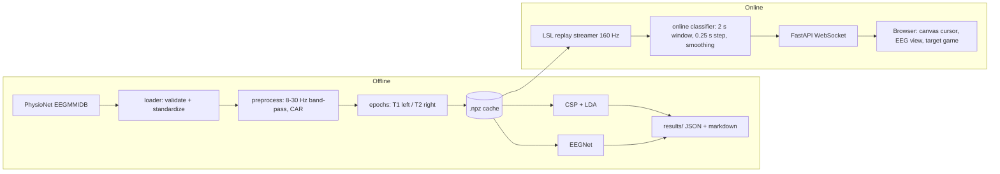

# NeuroLink-lite: Thought-Controlled Cursor (EEG + Deep Learning)

> **Status:** work in progress (Phase 0, skeleton). Results and demo will be added phase by phase.

NeuroLink-lite is a small, honest, open-source brain-computer interface (BCI) project.
It classifies EEG recorded while a person *imagines* moving their left or right hand, and
uses that prediction to move a cursor in the browser in real time. There is no hardware:
recorded data from PhysioNet is replayed over Lab Streaming Layer (LSL) as if it were live.

## Architecture



## Dataset

PhysioNet **EEG Motor Movement/Imagery Dataset** (EEGMMIDB): 109 subjects, 64 channels,
160 Hz. We use the motor-imagery runs 4, 8 and 12 (imagine opening/closing left or right
fist). Annotations: `T0` rest, `T1` left, `T2` right. Data is downloaded with
`mne.datasets.eegbci.load_data` into `data/` (git-ignored). Subjects with inconsistent
sampling rate or recording length are detected, reported and skipped.

## Results

Left vs right hand motor imagery, 105 valid subjects (S088, S092, S100 are 128 Hz and S104
has a truncated run; all four are detected and skipped automatically). 45 epochs per
subject, 4725 in total, chance = 50 %. Full tables and confusion matrices are in
[`results/RESULTS.md`](results/RESULTS.md); raw numbers in `results/*.json`.

| Model | Channels | Within-subject 5-fold | Cross-subject 5-fold (subject-grouped) | CPU time |
|-------|----------|----------------------:|---------------------------------------:|---------:|
| CSP + LDA | 64 | 59.9 +/- 20.4 % (24/105 subjects >= 70 %) | 62.1 +/- 1.8 % | 3 min |
| CSP + LDA | 21 motor | 61.3 +/- 21.7 % (31/105 subjects >= 70 %) | 62.3 +/- 1.3 % | 0.5 min |
| EEGNet-8,2 | 21 motor | 59.0 +/- 18.8 % (22/105 subjects >= 70 %) | **65.0 +/- 1.8 %** | 35 min |

Within-subject numbers are mean over subject x fold; cross-subject over the 5 folds.
EEGNet: 100 training epochs per within-subject fold, 30 per cross-subject fold, Adam 1e-3,
batch 32, dropout 0.5, seed 42, 4 CPU threads. Confusion matrices:
[`results/figures/`](results/figures/).

| EEGNet cross-subject | CSP+LDA (motor) cross-subject |
|---|---|
|  |  |

**Reading these numbers honestly.** Both models are weak in absolute terms, and that is the
real picture for this dataset rather than a bug:

- *Within-subject* training uses only 36 epochs per fold, far too few for either a 64 x 64
  covariance estimate or a neural network, so the per-subject spread is huge (0-100 %).
  About a quarter of subjects are clearly decodable (>= 70 %), many sit at chance; this
  matches the well-known "BCI illiteracy" spread reported for EEGMMIDB. EEGNet and CSP+LDA
  agree on who is decodable (per-subject correlation 0.74) and EEGNet is slightly worse here
  (-2.3 points on average), as expected for a data-starved network.
- *Cross-subject* trains on ~3800 epochs. CSP filters do not transfer well across heads and
  plateau at 62 %; EEGNet learns more transferable temporal/spatial filters and reaches
  65 %, the best number in this project. It is still far from usable for a naive user.
- The 21-channel motor subset is as good as or better than all 64 channels and 5-8x faster,
  so EEGNet and the real-time system use it.

## How to run

```bash
# Requires Python 3.11+ and uv (https://docs.astral.sh/uv/)
uv sync --extra dev
uv run neurolink --help

# Phase 1: fetch and preprocess the development subset (subjects 1-10, ~75 MB)
uv run neurolink download --subjects dev
uv run neurolink preprocess --subjects dev            # 64 channels, CAR on
uv run neurolink preprocess --subjects dev --channels motor --no-car
```

`preprocess` writes `data/cache/dataset_<hash>.npz` (keyed by every preprocessing
parameter) and prints which subjects were skipped and why, for example:

```
skipped subjects (1):
  S088: run 4: sampling rate 128 Hz != 160 Hz; run 8: ...; run 12: ...
```

Frontend (Vite + TypeScript):

```bash
cd frontend
npm install
npm run dev
```

## Development

```bash
uv run ruff check . && uv run ruff format .
uv run mypy
uv run pytest
```

## Limitations

_To be written in Phase 6._ Honest notes about accuracy ceilings on EEGMMIDB,
cross-subject generalization, and the gap between replayed data and a live headset.

## License

MIT
