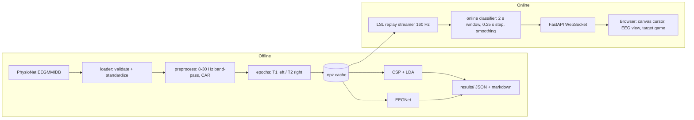

# NeuroLink-lite: Thought-Controlled Cursor (EEG + Deep Learning)

> **Status:** work in progress (Phase 0, skeleton). Results and demo will be added phase by phase.

NeuroLink-lite is a small, honest, open-source brain-computer interface (BCI) project.
It classifies EEG recorded while a person *imagines* moving their left or right hand, and
uses that prediction to move a cursor in the browser in real time. There is no hardware:
recorded data from PhysioNet is replayed over Lab Streaming Layer (LSL) as if it were live.

## Architecture



## Dataset

PhysioNet **EEG Motor Movement/Imagery Dataset** (EEGMMIDB): 109 subjects, 64 channels,
160 Hz. We use the motor-imagery runs 4, 8 and 12 (imagine opening/closing left or right
fist). Annotations: `T0` rest, `T1` left, `T2` right. Data is downloaded with
`mne.datasets.eegbci.load_data` into `data/` (git-ignored). Subjects with inconsistent
sampling rate or recording length are detected, reported and skipped.

## Results

_To be filled in after Phase 2 and Phase 3._

| Model | Protocol | Accuracy | Notes |
|-------|----------|----------|-------|
| CSP + LDA | within-subject 5-fold | TBD | |
| CSP + LDA | cross-subject leave-subjects-out | TBD | |
| EEGNet | within-subject 5-fold | TBD | |
| EEGNet | cross-subject leave-subjects-out | TBD | |

## How to run

```bash
# Requires Python 3.11+ and uv (https://docs.astral.sh/uv/)
uv sync --extra dev
uv run neurolink --help
```

Frontend (Vite + TypeScript):

```bash
cd frontend
npm install
npm run dev
```

## Development

```bash
uv run ruff check . && uv run ruff format .
uv run mypy
uv run pytest
```

## Limitations

_To be written in Phase 6._ Honest notes about accuracy ceilings on EEGMMIDB,
cross-subject generalization, and the gap between replayed data and a live headset.

## License

MIT
