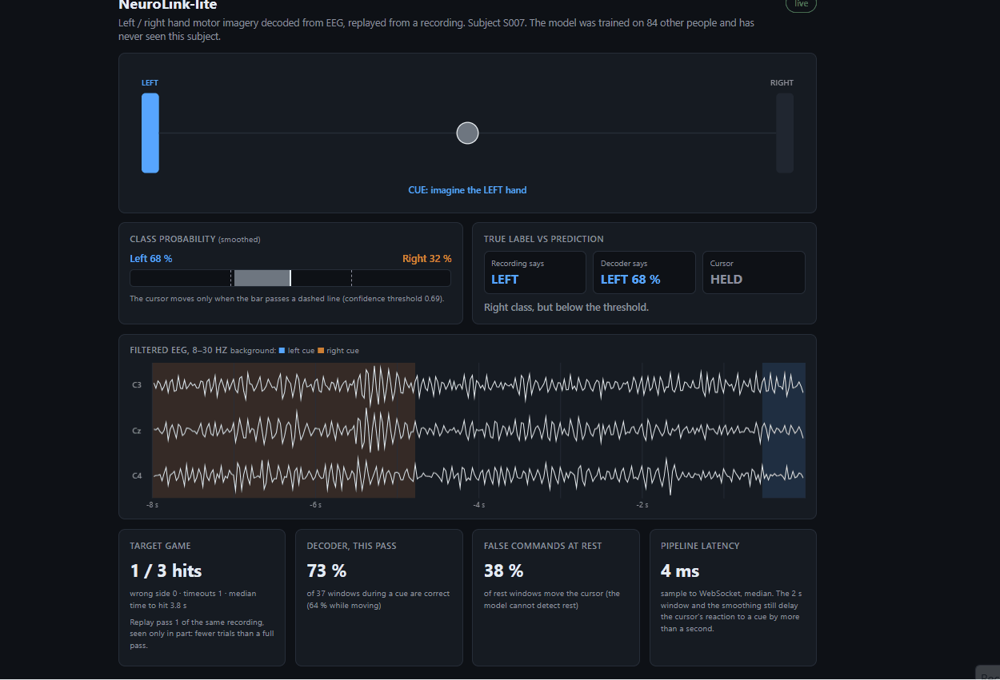
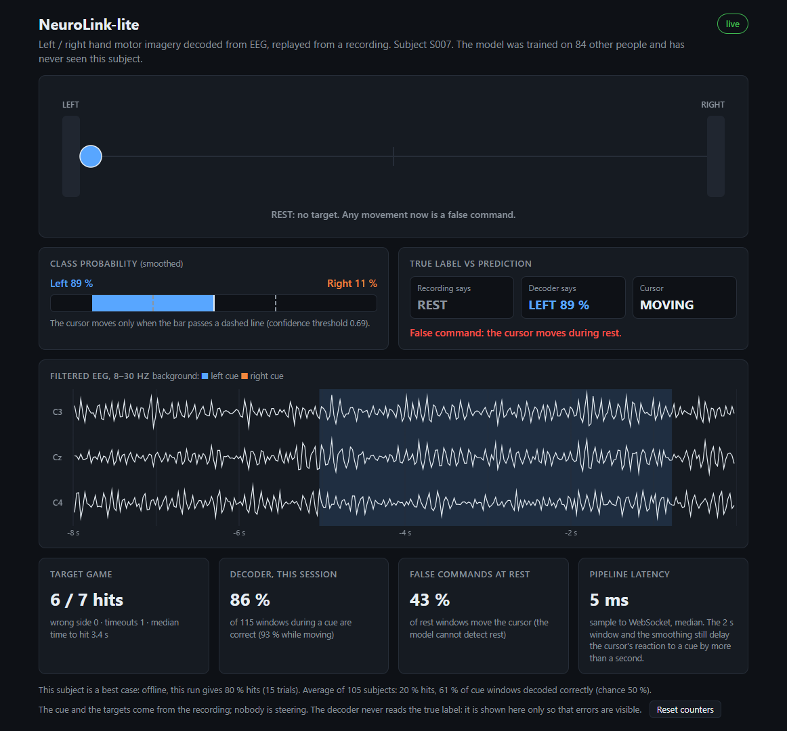
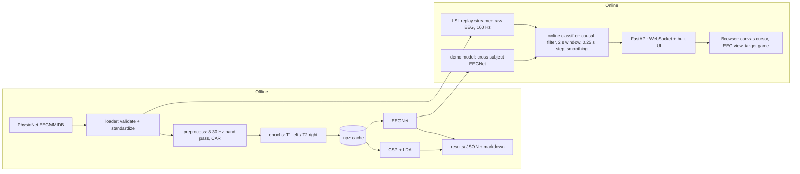

# NeuroLink-lite: Thought-Controlled Cursor (EEG + Deep Learning)

[](https://github.com/efusha0/neurolink-lite/actions/workflows/ci.yml)
[](LICENSE)

NeuroLink-lite is a small, honest, open-source brain-computer interface (BCI) project.
It classifies EEG recorded while a person *imagines* moving their left or right hand, and
uses that prediction to move a cursor in the browser in real time. There is no hardware:
recorded data from PhysioNet is replayed over Lab Streaming Layer (LSL) as if it were live.

<!-- Demo GIF: record it as described in docs/demo-gif.md, save it as docs/demo.gif,
     uncomment the next line and delete the screenshot line below this comment (the
     screenshot stays in the "Browser UI" section).

-->



It is built to show the whole path from raw EEG to a moving cursor, and to report what
that path is really worth: every number below is measured on held-out data, the demo
subject is labelled as the best case it is, and the things that do not work are listed.

## Quick start: the demo

```bash
# Needs Python 3.11+, uv (https://docs.astral.sh/uv/) and Node.js 22.12+ (https://nodejs.org)
git clone https://github.com/efusha0/neurolink-lite.git
cd neurolink-lite
uv sync
uv run neurolink demo
```

One command replays a recorded run as a live LSL stream, classifies it every 0.25 s and
opens the page at `http://127.0.0.1:8000`. Stop it with Ctrl+C. Nothing has to be trained:

- **Model.** The trained demo model ships with the repository
  (`data/models/demo_model.pt`, 17 kB; see [Data & License](#data--license)).
- **Recording.** The one run that is replayed (subject S007, run 12, 2.6 MB) is downloaded
  from PhysioNet on the first run.
- **Page.** The browser UI is built on the first run, which is the only step that needs
  Node.js; without it the command says what to install. In a fresh clone the first run
  was up after about 50 s (download, `npm ci`, build); later runs start in about 5 s.

`uv run neurolink demo --help` lists the options (`--port`, `--no-open`, `--rebuild-ui`, ...).

## Results at a glance

Left vs right hand motor imagery, 105 subjects, chance = 50 %. Details and the reasoning
behind every number are in the sections below.

| Question | Answer |
|---|---|
| Offline accuracy, best model (EEGNet trained on other subjects) | 65.0 +/- 13.2 % across subjects; 35 of 105 subjects reach 70 % |
| The same kind of model run the way a live system runs | 64.1 % while the window is inside a trial, 61.0 % over all trial windows |
| Does it know when the user is resting? | No. 28 % of rest windows move the cursor, as many as imagery windows (29 %) |
| Computation latency, sample to browser socket | 9.3 ms median, 15.3 ms p95 |
| Time from a cue to the cursor moving the right way | 1.65 s median for the demo subject; for the average subject it mostly never happens within a trial |
| "Reach the target" game, demo subject (best case) | 12 of 15 targets on the held-out run |
| "Reach the target" game, mean of all subjects | 19.6 % of targets |

**Inter-subject variability is the main story.** Per-subject accuracy ranges from below
chance to 96 %: about a third of the subjects can be decoded usefully and many cannot be
decoded at all with this kind of model (often called "BCI illiteracy"). The live demo
replays subject S007, one of the easiest subjects, through a model that has never seen
them. That is a best case, chosen by a rule and labelled as such; the average over all
subjects is reported next to every demo number.

## Architecture



| Part | Where |
|---|---|
| Loading, validation, filtering, epoching, caching | `src/neurolink/data/` |
| CSP + LDA, EEGNet, training | `src/neurolink/models/` |
| Evaluation protocols, pseudo-online scoring, game simulation, reports | `src/neurolink/eval/` |
| LSL streamer, online decoder, WebSocket server, demo | `src/neurolink/realtime/` |
| Browser UI (Vite + TypeScript + Canvas, no framework) | `frontend/` |
| Result files (JSON, markdown, figures) | `results/` |
| Design decisions, phase by phase | [`docs/architecture.md`](docs/architecture.md) |

## Dataset

PhysioNet **EEG Motor Movement/Imagery Dataset** (EEGMMIDB): 109 subjects, 64 channels,
160 Hz. We use the motor-imagery runs 4, 8 and 12 (imagine opening/closing left or right
fist). Annotations: `T0` rest, `T1` left, `T2` right. Data is downloaded with
`mne.datasets.eegbci.load_data` into `data/` (git-ignored). Subjects with inconsistent
sampling rate or recording length are detected, reported and skipped. Citations and
license: [Data & License](#data--license).

## Results

Left vs right hand motor imagery, 105 valid subjects (S088, S092, S100 are 128 Hz and S104
has a truncated run; all four are detected and skipped automatically). 45 epochs per
subject, 4725 in total, chance = 50 %. Full tables and confusion matrices are in
[`results/RESULTS.md`](results/RESULTS.md); raw numbers in `results/*.json`.

| Model | Channels | Within-subject 5-fold | Cross-subject 5-fold (subject-grouped) | CPU time |
|-------|----------|----------------------:|---------------------------------------:|---------:|
| CSP + LDA | 64 | 59.9 +/- 15.5 % (24/105 subjects >= 70 %) | 62.1 +/- 12.6 % (31/105 subjects >= 70 %) | 3 min |
| CSP + LDA | 21 motor | 61.3 +/- 16.5 % (31/105 subjects >= 70 %) | 62.3 +/- 12.8 % (29/105 subjects >= 70 %) | 0.5 min |
| EEGNet-8,2 | 21 motor | 59.0 +/- 14.1 % (22/105 subjects >= 70 %) | **65.0 +/- 13.2 %** (35/105 subjects >= 70 %) | 23-35 min |

Numbers are mean +/- standard deviation **across subjects** (each subject's accuracy over
its own 45 test epochs), so the +/- shows inter-subject variability, not measurement
noise. Across the 5 cross-subject folds the std is only 1.3-1.8 points.
EEGNet: 100 training epochs per within-subject fold, 30 per cross-subject fold, Adam 1e-3,
batch 32, dropout 0.5, seed 42, 4 CPU threads. Confusion matrices:
[`results/figures/`](results/figures/).

| EEGNet cross-subject | CSP+LDA (motor) cross-subject |
|---|---|
|  |  |

**Reading these numbers honestly.** Both models are weak in absolute terms, and that is the
real picture for this dataset rather than a bug:

- *Within-subject* training uses only 36 epochs per fold, far too few for either a 64 x 64
  covariance estimate or a neural network, so the per-subject spread is huge (27-100 %).
  About a quarter of subjects are clearly decodable (>= 70 %), many sit at chance; this
  matches the well-known "BCI illiteracy" spread reported for EEGMMIDB. EEGNet and CSP+LDA
  agree on who is decodable (per-subject correlation 0.74) and EEGNet is slightly worse here
  (-2.3 points on average), as expected for a data-starved network.
- *Cross-subject* trains on ~3800 epochs. CSP filters do not transfer well across heads and
  plateau at 62 %; EEGNet learns more transferable temporal/spatial filters and reaches
  65 %, the best number in this project (+2.7 points over CSP+LDA on the same channels,
  paired over subjects: t = 3.3, p = 0.001). It is still far from usable for a naive user:
  per-subject accuracy ranges from 29 % to 96 %, and only a third of subjects reach 70 %.
- The 21-channel motor subset is as good as or better than all 64 channels and 5-8x faster,
  so EEGNet and the real-time system use it.

## Real-time system

`neurolink stream` replays a recorded run over LSL as if it came from an amplifier: raw,
unfiltered 64-channel EEG at 160 Hz in 50 ms chunks, plus a marker stream with the true
state (rest / left / right). `neurolink serve` reads the EEG stream and, every 0.25 s,
classifies the last 2 s: common average reference, 21 motor channels, causal 8-30 Hz
band-pass (stateful 4th-order Butterworth), EEGNet, exponential smoothing of the class
probabilities (alpha = 0.3) and a confidence threshold. Each prediction goes out over a
WebSocket (`ws://127.0.0.1:8000/ws`) with probabilities, confidence, the true label (for
display only; the classifier never reads the markers) and its own latency.

### Offline vs pseudo-online accuracy

The offline numbers above use cue-aligned epochs and a zero-phase filter. A live system
has neither. "Pseudo-online" accuracy runs the exact online code (causal filter, windows
every 0.25 s that ignore the cue) over held-out continuous recordings and scores every
window against the annotation at its last sample. Mean +/- std across 105 subjects, in %:

| Model | Training filter | Offline (cue-aligned) | Pseudo-online, window inside the trial | Pseudo-online, all trial windows | Subjects >= 70 % |
|---|---|---:|---:|---:|---:|
| **EEGNet, cross-subject** (demo model) | causal | 66.0 +/- 13.7 | **64.1 +/- 12.1** | **61.0 +/- 8.7** | 32/105 |
| EEGNet, cross-subject | zero-phase | 65.0 +/- 13.2 | 64.2 +/- 11.6 | 61.2 +/- 8.2 | 31/105 |
| CSP+LDA, cross-subject | causal | 62.6 +/- 13.6 | 61.6 +/- 12.5 | 59.6 +/- 9.2 | 29/105 |
| CSP+LDA, cross-subject | zero-phase | 62.3 +/- 12.8 | 61.3 +/- 12.1 | 59.5 +/- 8.9 | 24/105 |
| CSP+LDA, per subject | causal | 62.7 +/- 18.0 | 61.4 +/- 16.1 | 58.6 +/- 11.7 | 32/105 |
| CSP+LDA, per subject | zero-phase | 62.5 +/- 16.4 | 61.5 +/- 15.2 | 58.6 +/- 11.6 | 29/105 |
| EEGNet, per subject | causal | 60.6 +/- 16.7 | 58.9 +/- 14.6 | 56.4 +/- 10.5 | 22/105 |
| EEGNet, per subject | zero-phase | 59.4 +/- 17.6 | 59.0 +/- 14.4 | 55.7 +/- 11.2 | 22/105 |

Cross-subject rows: the model of the fold that held the subject out, all three runs.
Per-subject rows: trained on runs 4 and 8, tested on run 12. "Inside the trial": the whole
2 s window lies in one left/right trial. "All trial windows": every window ending during a
trial, including those that still contain rest. ">= 70 %" counts subjects by the
inside-the-trial accuracy. Full table: [`results/RESULTS.md`](results/RESULTS.md).

- **The filter mismatch costs nothing measurable.** Training on zero-phase data and running
  with a causal filter (rows "zero-phase") is within -0.1 to +0.3 points of training on
  causally filtered data, for all four model families (paired over subjects,
  p = 0.41-0.83). The online model is trained on causal data anyway, so that training and
  live preprocessing are identical.
- **Window alignment is what costs accuracy.** Going from cue-aligned epochs to free-running
  windows loses about 1-2 points while the window is inside the trial, and 3-5 points once
  every window that ends during a trial is counted (5 points for the demo model: 66.0 to
  61.0 %). After a cue the 2 s window still contains mostly rest, so the decoder needs
  time to catch up.
- **The demo model** is the cross-subject EEGNet trained on causal data, chosen by one
  criterion fixed in advance: the highest mean pseudo-online accuracy across subjects. It
  was not chosen by how the demo looks on the replayed run.

### The model does not detect rest ("Midas touch")

The cursor moves only when the smoothed confidence passes a threshold, set on training
subjects so that 25 % of their *rest* windows pass. On held-out subjects 28 % of rest
windows and 29 % of imagery windows pass: the model is as confident while the person rests
as while they imagine a movement. The threshold therefore **does not detect rest**. It only
mutes low-confidence predictions (accuracy over the imagery windows that pass is 71 %,
against 61 % over all of them). This is the "Midas touch" problem known from the BCI
literature (the term comes from gaze-controlled interfaces): a decoder that only knows
"left" and "right" turns every moment into a command, including the moments when the user
intends nothing. Solving it needs an explicit idle state (a third class or a separate
control/no-control detector); this project does not attempt that, and the UI shows the true
state next to the prediction so the effect is visible rather than hidden.

### The demo subject is a best case

The demo replays run 12 of subject S007 through a model that has never seen S007. The
subject was picked by rule from runs 4 and 8 only (the subject the held-out model decodes
best there; a three-way tie was broken by pseudo-online accuracy on the same two runs), so
run 12 was not used to pick the model or the subject. The rule deliberately picks a subject
who is easy to decode:

| | Offline | Pseudo-online, inside the trial | Pseudo-online, all trial windows | Rest windows moving the cursor | Imagery windows moving the cursor |
|---|---:|---:|---:|---:|---:|
| S007, run 12 (the demo) | 100.0 % | 100.0 % | 87.0 % | 53.5 % | 64.2 % |
| Average of 105 subjects | 66.0 % | 64.1 % | 61.0 % | 28.0 % | 28.7 % |

Run 12 holds only 15 cue-aligned epochs and 129 windows inside a trial, so the S007 row is
a coarse estimate (over all three runs the same model scores 97.8 % offline and 96.1 % /
83.5 % pseudo-online for S007).

What the demo shows is what the system does for one of the most decodable subjects.
For a typical subject it is right about 61 % of the time, and for most subjects it is not
usable as a controller. Even for S007 the cursor moves during about half of the rest
windows.

### Latency

Measured with `neurolink latency`: streamer, classifier, server and a WebSocket client on
one machine (Intel CPU with 16 logical cores, Windows, no GPU), 465 predictions over
120 s. Latency is counted from the LSL timestamp of the newest sample of a window.

| Stage | p50 | p95 | p99 | max |
|---|---:|---:|---:|---:|
| Sample acquired -> smoothed prediction (LSL transport, filter, EEGNet) | 6.4 ms | 10.4 ms | 13.7 ms | 17.9 ms |
| Prediction -> handed to the WebSocket | 1.3 ms | 3.6 ms | 4.2 ms | 4.8 ms |
| **End to end**: sample acquired -> received by a WebSocket client | 9.3 ms | 15.3 ms | 18.0 ms | 23.5 ms |

The 2 s analysis window is not included: it is not delay of the pipeline, but it does slow
down the reaction to a change of intent (see "window alignment" above). Browser rendering
is not included either. In this measurement every window ends on a chunk boundary (50 ms
chunks, 250 ms step). When it does not, the prediction additionally waits for the chunk to
complete: with 200 ms chunks the same measurement gives p50 54 ms and p95 165 ms end to
end (225 predictions over 60 s).

### Behavioural latency: what the user actually feels

The 9-15 ms above are **computation latency only**: how long the pipeline needs to turn
a new sample into a prediction. The delay a user would feel is far longer, because the
decoder looks at the last 2 s and smooths its output (the EMA with alpha = 0.3 has a time
constant of about 0.7 s). After a cue, the window first has to fill with imagery data.

This behavioural latency is measured on the pseudo-online outputs (the same held-out data
as above): for each left/right trial (4.1 s long), the time from the trial onset to the
end of the first window whose smoothed prediction is the trial's class **and** above the
confidence threshold, i.e. until the cursor starts moving the right way.

| Data | Trials | Reached before the trial ends | Median | p25-p75 | p90 | Within 1 s | Within 2 s |
|---|---:|---:|---:|---:|---:|---:|---:|
| S007, run 12 (the demo): trials that need a change of output | 12 | 11 (91.7 %) | 1.65 s | 1.30-2.12 s | 2.35 s | 0.0 % | 66.7 % |
| S007, run 12: all trials | 15 | 14 (93.3 %) | 1.52 s | 1.10-1.93 s | 2.32 s | 20.0 % | 73.3 % |
| S007, all three runs: trials that need a change of output | 33 | 26 (78.8 %) | 1.65 s | 1.16-2.46 s | 3.02 s | 12.1 % | 51.5 % |
| All 105 subjects: trials that need a change of output | 3853 | 999 (25.9 %) | 1.80 s | 0.80-2.70 s | 3.50 s | 7.9 % | 14.7 % |
| All 105 subjects: all trials | 4725 | 1836 (38.9 %) | 0.45 s | 0.15-2.00 s | 3.02 s | 23.5 % | 29.2 % |

Median, quartiles and p90 are over the trials in which the condition is reached; "within"
is the share of all trials of the row.

- **Demo subject: about 1.65 s.** For S007 on run 12 the cursor starts moving the right way a
  median of 1.65 s after the cue, never within the first second, and in one of
  12 trials not at all. That is roughly 180 times the computation latency. Only
  12 trials stand behind this number.
- **"Trials that need a change of output" is the meaningful row.** In 18.5 % of all
  trials (3 of 15 for S007 on run 12) the last window *before* the cue already showed
  the coming class above the threshold. Those trials "react" within a fraction of a
  second, but that is carry-over from what the decoder happened to output during rest
  (the Midas touch again), not a reaction. Counting them makes the all-subject median
  look fast (0.45 s) while 20 % of all trials are "right" within 0.5 s, when the
  window still holds at least 1.5 s of rest.
- **For the average subject the question is mostly "whether", not "when".** Across all
  subjects only 26 % of the trials that need a change ever get the cursor moving the
  right way before the trial ends (median 1.80 s when they do). The first above-threshold
  output of a trial is the right class in 34.5 % of trials, the wrong class in
  20.3 %, and there is none in 45.2 %.

### Browser UI


The page (Vite + TypeScript + Canvas, no framework) shows what the decoder does and, next
to it, what it should have done:

- **Cursor and target.** The cursor moves along a line with velocity
  (p_right - p_left) / travel time while the prediction is above the confidence threshold,
  and stands still otherwise.
- **Class probability bar** with the threshold drawn in.
- **True label vs prediction.** The state of the recording (rest / left / right) beside the
  decoder output, with a verdict for the current window.
- **Filtered EEG** of C3, Cz and C4 (the last 8 s), shaded by the true cue.
- **Counters** for the current pass of the replay: game score, accuracy during cues,
  share of rest windows that move the cursor, and the pipeline latency.

**The target game follows the recording.** Nobody is steering, so the user cannot pick a
target. When a trial starts the cursor returns to the centre and the target is the wall
on the cued side; reaching it before the trial ends (4.1 s) is a hit, reaching the other
wall is a wrong-side hit, otherwise the trial is a timeout.

The only free parameter is the cursor speed. It was chosen on runs 4 and 8 of the demo
subject only, by simulating the game on the pseudo-online outputs for a grid of travel
times fixed beforehand and taking the one with the most hits minus wrong-side hits (ties
go to the slower cursor). That gave a travel time of 1 s. The result on the replayed
run 12 is reported as it came out:

| Data | Trials | Hits | Wrong side | Timeouts |
|---|---:|---:|---:|---:|
| S007, runs 4 and 8 (used to choose the speed) | 30 | 14 (46.7 %) | 2 | 14 |
| S007, run 12 (the demo) | 15 | 12 (80.0 %) | 0 | 3 |
| Mean of 105 subjects, all runs, same speed | 45 each | 19.6 % | 7.0 % | 73.4 % |

The demo run happens to be the better part of this subject's data (80.0 % of targets
against 46.7 % on the two runs the speed was chosen on); that is how the split fell, not
a choice. For the average subject the game is mostly timeouts: 0 of 105 subjects hit
70 % of their targets over all three runs. A hit takes a median of 3.3 s of the 4.1 s
trial.

**The counters cover one pass of the run.** The streamer replays run 12 in a loop and
numbers the passes; the page starts its counters again with every pass and lists the
scores of the earlier ones, so what is on screen can be compared with the "12 of 15"
above. A pass the page saw only in part (it was opened in the middle, or the connection
dropped) is marked as such, and a trial that was already running when the page connected
is not scored.

**The game runs on stream time.** Each prediction moves the cursor for exactly one
decoder step (0.25 s), whether or not the browser drew a frame in between. The first
version moved the cursor only when a frame was drawn, and a browser tab in the background
draws none: with the page left open behind another window it showed 24 hits in 52 trials
with 28 timeouts, while the decoder was right in 87 % of the cue windows. That was a bug
of the page, not a property of the decoder. Checked in headless Chrome after the fix,
with the tab hidden for more than four minutes: the pass played entirely in the background
scored 12 of 15 hits with no wrong-side hit, and the pass the page had joined after its
first trial 12 of 14, as in the simulation.

## How to run

The demo needs only the [quick start](#quick-start-the-demo). Everything else reproduces
the results from scratch.

```bash
# Requires Python 3.11+ and uv (https://docs.astral.sh/uv/)
uv sync --extra dev
uv run neurolink --help

# Data pipeline on the development subset (subjects 1-10, ~75 MB)
uv run neurolink download --subjects dev
uv run neurolink preprocess --subjects dev            # 64 channels, CAR on
uv run neurolink preprocess --subjects dev --channels motor --no-car
```

Offline experiments and the real-time measurements (all 109 subjects, about 0.8 GB of EDF
files):

```bash
uv run neurolink download --subjects all
uv run neurolink train-csp                    # CSP + LDA, both protocols
uv run neurolink train-csp --channels motor
uv run neurolink train-eegnet                 # EEGNet, both protocols
uv run neurolink pseudo-online                # online pipeline on held-out data
uv run neurolink train-demo                   # trains and saves data/models/demo_model.pt
uv run neurolink latency                      # end-to-end latency measurement
uv run neurolink behavioural-latency          # reaction to the cue, from pseudo-online outputs
uv run neurolink game-speed                   # cursor speed for the UI, from runs 4 and 8
uv run neurolink report                       # regenerate results/RESULTS.md and the figures
```

`pseudo-online` trains every candidate model and takes a while on a CPU; its results are
committed under `results/`, so `train-demo` can be run directly. `train-demo` overwrites
the shipped model with one trained on your machine (same data, same seed).

`preprocess` writes `data/cache/dataset_<hash>.npz` (keyed by every preprocessing
parameter) and prints which subjects were skipped and why, for example:

```
skipped subjects (1):
  S088: run 4: sampling rate 128 Hz != 160 Hz; run 8: ...; run 12: ...
```

The demo, piece by piece (what `neurolink demo` does in one process):

```bash
uv run neurolink stream                       # terminal 1: replay the demo run over LSL
uv run neurolink serve                        # terminal 2: classifier + WebSocket server
cd frontend && npm install && npm run dev     # terminal 3: UI with hot reload, http://localhost:5173
```

`neurolink serve` also serves the built page on `http://127.0.0.1:8000` when
`frontend/dist` exists.

To record the demo GIF shown at the top, see [`docs/demo-gif.md`](docs/demo-gif.md).

## Development

```bash
uv run ruff check . && uv run ruff format .
uv run mypy
uv run pytest

cd frontend                                   # Node.js 22.12 or newer
npm ci
npm run typecheck && npm test && npm run build
```

CI (GitHub Actions) runs the same checks on every push.

## Limitations

- **Accuracy is low in absolute terms.** The best model is right about 65 % of the time on
  a two-class problem where chance is 50 %, and only a third of the subjects reach the
  70 % usually quoted as the minimum for a usable BCI. This is in line with what is
  reported for EEGMMIDB with few trials per subject; it is not state of the art, and no
  hyper-parameter search was done beyond the EEGNet defaults and a training budget.
- **Large inter-subject variability ("BCI illiteracy").** Per-subject accuracy spans 29 %
  to 96 % for the cross-subject EEGNet. The demo subject (S007) is a best case and the
  average is reported next to it; for most subjects the system is not a usable controller.
- **The 10 development subjects overlap the evaluation set.** Subjects 1-10 were used for
  sanity sweeps and for choosing the EEGNet training budget, and they are also part of
  the 105-subject evaluation, so the reported accuracies carry a small optimistic bias.
- **Offline accuracy is not live accuracy.** Offline numbers use cue-aligned epochs and a
  zero-phase filter; a live system has neither. The pseudo-online accuracy is the honest
  estimate (see the offline vs pseudo-online table): the filter mismatch costs nothing
  measurable (-0.1 to +0.3 points, p = 0.41-0.83), window alignment costs 3-5 points from
  offline accuracy to all live trial windows (5 points for the demo model, 66.0 to
  61.0 %).
- **The model does not detect rest.** The confidence threshold only mutes low-confidence
  predictions; rest windows move the cursor as often as imagery windows (28 % vs 29 %).
  This is the "Midas touch" problem, and it would make free, self-paced control
  impossible even for a well-decoded subject.
- **Selection effects.** The demo model was the best of eight candidates on the same
  held-out data, so its own pseudo-online number is slightly optimistic. The demo subject
  was picked for being easy to decode (on runs 4 and 8), and the replayed run 12 then
  turned out to be the better part of that subject's data.
- **Small numbers behind the demo.** Run 12 holds 15 trials: "12 of 15 targets" and
  "1.65 s" are coarse estimates for one subject on one run.
- **Latency is computation latency.** The 9-15 ms exclude browser rendering and were
  measured on one machine with replayed data. The behavioural latency (cue to the cursor
  moving the right way) is about 1.65 s for the demo subject, and for the average subject
  the cursor mostly never gets there within a trial.
- **Replayed data is not a live headset.** The recording is open loop: the person never
  saw this cursor, so there is no feedback, no learning and no frustration, all of which
  change the EEG in a real session. There are no fresh electrode problems, no movement
  artefacts beyond those already in the data, and no clock drift. The target game follows
  the recording because nobody is steering.
- **One dataset, one session per subject, two classes.** Nothing here says how the models
  would do on another amplifier, on another day for the same person, or with more
  commands.
- **The page is tested as logic, not as a page.** Game, counters, buffers and message
  parsing have unit tests; drawing and the WebSocket wiring were checked by running the
  stack in a real browser, not by an automated end-to-end test.

## Data & License

**Data.** All EEG comes from the EEG Motor Movement/Imagery Dataset on PhysioNet
(https://physionet.org/content/eegmmidb/1.0.0/), recorded with the BCI2000 system. The
dataset is made available under the **Open Data Commons Attribution License v1.0
(ODC-By v1.0)**, https://opendatacommons.org/licenses/by/1-0/. No recording is stored in
this repository; the code downloads what it needs from PhysioNet. If you use the data,
cite:

- Schalk, G., McFarland, D. J., Hinterberger, T., Birbaumer, N., & Wolpaw, J. R. (2009).
  *EEG Motor Movement/Imagery Dataset* (version 1.0.0). PhysioNet.
  https://doi.org/10.13026/C28G6P
- Schalk, G., McFarland, D. J., Hinterberger, T., Birbaumer, N., & Wolpaw, J. R. (2004).
  BCI2000: A General-Purpose Brain-Computer Interface (BCI) System. *IEEE Transactions on
  Biomedical Engineering*, 51(6), 1034-1043. https://doi.org/10.1109/TBME.2004.827072
- Goldberger, A. L., et al. (2000). PhysioBank, PhysioToolkit, and PhysioNet: Components
  of a New Research Resource for Complex Physiologic Signals. *Circulation*, 101(23),
  e215-e220. https://doi.org/10.1161/01.CIR.101.23.e215

**Demo model.** `data/models/demo_model.pt` (17 kB) is an EEGNet-8,2 trained with this
code on that dataset: the motor-imagery runs 4, 8 and 12 of 84 subjects (3780 epochs), 21
channels over the motor cortex, common average reference, causal 8-30 Hz band-pass, 30
training epochs, seed 42. It is the model of the cross-subject fold that holds out the
demo subject S007 and 20 others, so it has never seen the subject it is shown on. The
file contains network weights, per-channel normalization statistics, channel names and
the online settings (window, step, smoothing, confidence threshold); it contains no EEG
recordings. As a work derived from the dataset it is shared with the attribution above.
`uv run neurolink train-demo` reproduces it.

**Results.** The numbers, tables and figures under `results/` are derived from the same
dataset; the attribution above applies to them as well.

**Code.** MIT, see [`LICENSE`](LICENSE).

**Methods.** EEGNet: Lawhern, V. J., et al. (2018). EEGNet: a compact convolutional neural
network for EEG-based brain-computer interfaces. *Journal of Neural Engineering*, 15(5),
056013. https://doi.org/10.1088/1741-2552/aace8c
