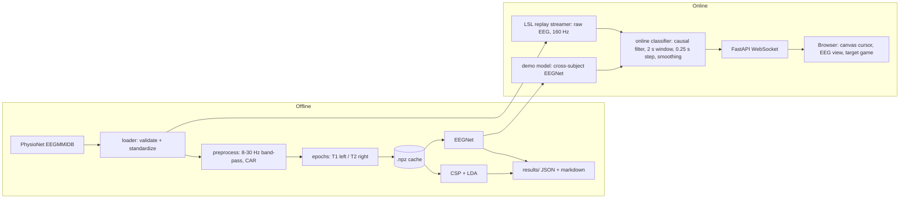
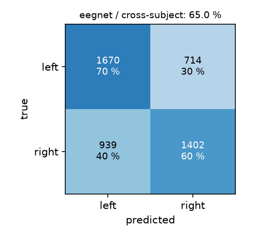
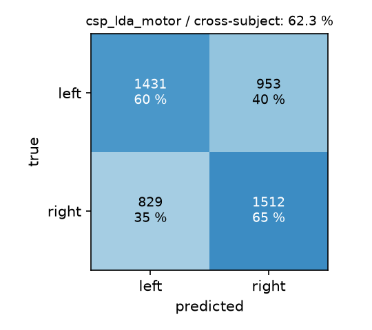

# NeuroLink-lite: Thought-Controlled Cursor (EEG + Deep Learning)

> **Status:** work in progress. Data pipeline, CSP+LDA baseline, EEGNet and the real-time
> system (LSL replay, online classifier, WebSocket server) are done (Phases 0-4); the
> browser UI and the one-command demo are next.

NeuroLink-lite is a small, honest, open-source brain-computer interface (BCI) project.
It classifies EEG recorded while a person *imagines* moving their left or right hand, and
uses that prediction to move a cursor in the browser in real time. There is no hardware:
recorded data from PhysioNet is replayed over Lab Streaming Layer (LSL) as if it were live.

## Architecture



## Dataset

PhysioNet **EEG Motor Movement/Imagery Dataset** (EEGMMIDB): 109 subjects, 64 channels,
160 Hz. We use the motor-imagery runs 4, 8 and 12 (imagine opening/closing left or right
fist). Annotations: `T0` rest, `T1` left, `T2` right. Data is downloaded with
`mne.datasets.eegbci.load_data` into `data/` (git-ignored). Subjects with inconsistent
sampling rate or recording length are detected, reported and skipped.

## Results

Left vs right hand motor imagery, 105 valid subjects (S088, S092, S100 are 128 Hz and S104
has a truncated run; all four are detected and skipped automatically). 45 epochs per
subject, 4725 in total, chance = 50 %. Full tables and confusion matrices are in
[`results/RESULTS.md`](results/RESULTS.md); raw numbers in `results/*.json`.

| Model | Channels | Within-subject 5-fold | Cross-subject 5-fold (subject-grouped) | CPU time |
|-------|----------|----------------------:|---------------------------------------:|---------:|
| CSP + LDA | 64 | 59.9 +/- 15.5 % (24/105 subjects >= 70 %) | 62.1 +/- 12.6 % (31/105 subjects >= 70 %) | 3 min |
| CSP + LDA | 21 motor | 61.3 +/- 16.5 % (31/105 subjects >= 70 %) | 62.3 +/- 12.8 % (29/105 subjects >= 70 %) | 0.5 min |
| EEGNet-8,2 | 21 motor | 59.0 +/- 14.1 % (22/105 subjects >= 70 %) | **65.0 +/- 13.2 %** (35/105 subjects >= 70 %) | 23-35 min |

Numbers are mean +/- standard deviation **across subjects** (each subject's accuracy over
its own 45 test epochs), so the +/- shows inter-subject variability, not measurement
noise. Across the 5 cross-subject folds the std is only 1.3-1.8 points.
EEGNet: 100 training epochs per within-subject fold, 30 per cross-subject fold, Adam 1e-3,
batch 32, dropout 0.5, seed 42, 4 CPU threads. Confusion matrices:
[`results/figures/`](results/figures/).

| EEGNet cross-subject | CSP+LDA (motor) cross-subject |
|---|---|
|  |  |

**Reading these numbers honestly.** Both models are weak in absolute terms, and that is the
real picture for this dataset rather than a bug:

- *Within-subject* training uses only 36 epochs per fold, far too few for either a 64 x 64
  covariance estimate or a neural network, so the per-subject spread is huge (27-100 %).
  About a quarter of subjects are clearly decodable (>= 70 %), many sit at chance; this
  matches the well-known "BCI illiteracy" spread reported for EEGMMIDB. EEGNet and CSP+LDA
  agree on who is decodable (per-subject correlation 0.74) and EEGNet is slightly worse here
  (-2.3 points on average), as expected for a data-starved network.
- *Cross-subject* trains on ~3800 epochs. CSP filters do not transfer well across heads and
  plateau at 62 %; EEGNet learns more transferable temporal/spatial filters and reaches
  65 %, the best number in this project (+2.7 points over CSP+LDA on the same channels,
  paired over subjects: t = 3.3, p = 0.001). It is still far from usable for a naive user:
  per-subject accuracy ranges from 29 % to 96 %, and only a third of subjects reach 70 %.
- The 21-channel motor subset is as good as or better than all 64 channels and 5-8x faster,
  so EEGNet and the real-time system use it.

## Real-time system

`neurolink stream` replays a recorded run over LSL as if it came from an amplifier: raw,
unfiltered 64-channel EEG at 160 Hz in 50 ms chunks, plus a marker stream with the true
state (rest / left / right). `neurolink serve` reads the EEG stream and, every 0.25 s,
classifies the last 2 s: common average reference, 21 motor channels, causal 8-30 Hz
band-pass (stateful 4th-order Butterworth), EEGNet, exponential smoothing of the class
probabilities (alpha = 0.3) and a confidence threshold. Each prediction goes out over a
WebSocket (`ws://127.0.0.1:8000/ws`) with probabilities, confidence, the true label (for
display only; the classifier never reads the markers) and its own latency.

### Offline vs pseudo-online accuracy

The offline numbers above use cue-aligned epochs and a zero-phase filter. A live system
has neither. "Pseudo-online" accuracy runs the exact online code (causal filter, windows
every 0.25 s that ignore the cue) over held-out continuous recordings and scores every
window against the annotation at its last sample. Mean +/- std across 105 subjects, in %:

| Model | Training filter | Offline (cue-aligned) | Pseudo-online, window inside the trial | Pseudo-online, all trial windows | Subjects >= 70 % |
|---|---|---:|---:|---:|---:|
| **EEGNet, cross-subject** (demo model) | causal | 66.0 +/- 13.7 | **64.1 +/- 12.1** | **61.0 +/- 8.7** | 32/105 |
| EEGNet, cross-subject | zero-phase | 65.0 +/- 13.2 | 64.2 +/- 11.6 | 61.2 +/- 8.2 | 31/105 |
| CSP+LDA, cross-subject | causal | 62.6 +/- 13.6 | 61.6 +/- 12.5 | 59.6 +/- 9.2 | 29/105 |
| CSP+LDA, cross-subject | zero-phase | 62.3 +/- 12.8 | 61.3 +/- 12.1 | 59.5 +/- 8.9 | 24/105 |
| CSP+LDA, per subject | causal | 62.7 +/- 18.0 | 61.4 +/- 16.1 | 58.6 +/- 11.7 | 32/105 |
| CSP+LDA, per subject | zero-phase | 62.5 +/- 16.4 | 61.5 +/- 15.2 | 58.6 +/- 11.6 | 29/105 |
| EEGNet, per subject | causal | 60.6 +/- 16.7 | 58.9 +/- 14.6 | 56.4 +/- 10.5 | 22/105 |
| EEGNet, per subject | zero-phase | 59.4 +/- 17.6 | 59.0 +/- 14.4 | 55.7 +/- 11.2 | 22/105 |

Cross-subject rows: the model of the fold that held the subject out, all three runs.
Per-subject rows: trained on runs 4 and 8, tested on run 12. "Inside the trial": the whole
2 s window lies in one left/right trial. "All trial windows": every window ending during a
trial, including those that still contain rest. ">= 70 %" counts subjects by the
inside-the-trial accuracy. Full table: [`results/RESULTS.md`](results/RESULTS.md).

- **The filter mismatch costs nothing measurable.** Training on zero-phase data and running
  with a causal filter (rows "zero-phase") is within -0.1 to +0.3 points of training on
  causally filtered data, for all four model families (paired over subjects,
  p = 0.41-0.83). The online model is trained on causal data anyway, so that training and
  live preprocessing are identical.
- **Window alignment is what costs accuracy.** Going from cue-aligned epochs to free-running
  windows loses about 1-2 points while the window is inside the trial, and 3-5 points once
  every window that ends during a trial is counted (5 points for the demo model: 66.0 to
  61.0 %). After a cue the 2 s window still contains mostly rest, so the decoder needs
  time to catch up.
- **The demo model** is the cross-subject EEGNet trained on causal data, chosen by one
  criterion fixed in advance: the highest mean pseudo-online accuracy across subjects. It
  was not chosen by how the demo looks on the replayed run.

### The model does not detect rest ("Midas touch")

The cursor moves only when the smoothed confidence passes a threshold, set on training
subjects so that 25 % of their *rest* windows pass. On held-out subjects 28 % of rest
windows and 29 % of imagery windows pass: the model is as confident while the person rests
as while they imagine a movement. The threshold therefore **does not detect rest**. It only
mutes low-confidence predictions (accuracy over the imagery windows that pass is 71 %,
against 61 % over all of them). This is the "Midas touch" problem known from the BCI
literature (the term comes from gaze-controlled interfaces): a decoder that only knows
"left" and "right" turns every moment into a command, including the moments when the user
intends nothing. Solving it needs an explicit idle state (a third class or a separate
control/no-control detector); this project does not attempt that, and the UI shows the true
state next to the prediction so the effect is visible rather than hidden.

### The demo subject is a best case

The demo replays run 12 of subject S007 through a model that has never seen S007. The
subject was picked by rule from runs 4 and 8 only (the subject the held-out model decodes
best there; a three-way tie was broken by pseudo-online accuracy on the same two runs), so
run 12 was not used to pick the model or the subject. The rule deliberately picks a subject
who is easy to decode:

| | Offline | Pseudo-online, inside the trial | Pseudo-online, all trial windows | Rest windows moving the cursor | Imagery windows moving the cursor |
|---|---:|---:|---:|---:|---:|
| S007, run 12 (the demo) | 100.0 % | 100.0 % | 87.0 % | 53.5 % | 64.2 % |
| Average of 105 subjects | 66.0 % | 64.1 % | 61.0 % | 28.0 % | 28.7 % |

Run 12 holds only 15 cue-aligned epochs and 129 windows inside a trial, so the S007 row is
a coarse estimate (over all three runs the same model scores 97.8 % offline and 96.1 % /
83.5 % pseudo-online for S007).

What the demo shows is what the system does for one of the most decodable subjects.
For a typical subject it is right about 61 % of the time, and for most subjects it is not
usable as a controller. Even for S007 the cursor moves during about half of the rest
windows.

### Latency

Measured with `neurolink latency`: streamer, classifier, server and a WebSocket client on
one machine (Intel CPU with 16 logical cores, Windows, no GPU), 465 predictions over
120 s. Latency is counted from the LSL timestamp of the newest sample of a window.

| Stage | p50 | p95 | p99 | max |
|---|---:|---:|---:|---:|
| Sample acquired -> smoothed prediction (LSL transport, filter, EEGNet) | 6.4 ms | 10.4 ms | 13.7 ms | 17.9 ms |
| Prediction -> handed to the WebSocket | 1.3 ms | 3.6 ms | 4.2 ms | 4.8 ms |
| **End to end**: sample acquired -> received by a WebSocket client | 9.3 ms | 15.3 ms | 18.0 ms | 23.5 ms |

The 2 s analysis window is not included: it is not delay of the pipeline, but it does slow
down the reaction to a change of intent (see "window alignment" above). Browser rendering
is not included either. In this measurement every window ends on a chunk boundary (50 ms
chunks, 250 ms step). When it does not, the prediction additionally waits for the chunk to
complete: with 200 ms chunks the same measurement gives p50 54 ms and p95 165 ms end to
end (225 predictions over 60 s).

## How to run

```bash
# Requires Python 3.11+ and uv (https://docs.astral.sh/uv/)
uv sync --extra dev
uv run neurolink --help

# Phase 1: fetch and preprocess the development subset (subjects 1-10, ~75 MB)
uv run neurolink download --subjects dev
uv run neurolink preprocess --subjects dev            # 64 channels, CAR on
uv run neurolink preprocess --subjects dev --channels motor --no-car
```

Offline experiments and the real-time system (all 109 subjects, about 0.8 GB of EDF files):

```bash
uv run neurolink download --subjects all
uv run neurolink train-csp                    # Phase 2: CSP + LDA, both protocols
uv run neurolink train-csp --channels motor
uv run neurolink train-eegnet                 # Phase 3: EEGNet, both protocols
uv run neurolink pseudo-online                # Phase 4: online pipeline on held-out data
uv run neurolink train-demo                   # trains and saves data/models/demo_model.pt

uv run neurolink stream                       # terminal 1: replay the demo run over LSL
uv run neurolink serve                        # terminal 2: classifier + WebSocket server
uv run neurolink latency                      # end-to-end latency measurement
```

`pseudo-online` trains every candidate model and takes a while on a CPU; its results are
committed under `results/`, so `train-demo` can be run directly.

`preprocess` writes `data/cache/dataset_<hash>.npz` (keyed by every preprocessing
parameter) and prints which subjects were skipped and why, for example:

```
skipped subjects (1):
  S088: run 4: sampling rate 128 Hz != 160 Hz; run 8: ...; run 12: ...
```

Frontend (Vite + TypeScript):

```bash
cd frontend
npm install
npm run dev
```

## Development

```bash
uv run ruff check . && uv run ruff format .
uv run mypy
uv run pytest
```

## Limitations

_To be written in Phase 6._ Honest notes about accuracy ceilings on EEGMMIDB,
cross-subject generalization, and the gap between replayed data and a live headset.

Points already known and to be covered there:

- The 10 development subjects (1-10) used for sanity sweeps and for choosing the EEGNet
  training budget are also part of the 105-subject evaluation, so reported accuracies
  carry a small optimistic bias.
- Offline accuracy uses cue-aligned epochs and a zero-phase filter; the online system
  cannot. The pseudo-online accuracy measured in Phase 4 is the honest estimate. Include
  the offline vs pseudo-online comparison table (see "Real-time system").
- Measured cost of the filter mismatch (zero-phase training, causal online filter): not
  significant, -0.1 to +0.3 points, p = 0.41-0.83.
- Loss from window alignment: 3-5 points from offline accuracy to all live trial windows
  (5 points for the demo model, 66.0 to 61.0 %).
- The model does not detect rest. The confidence threshold only mutes low-confidence
  predictions; rest windows move the cursor as often as imagery windows (28 % vs 29 %).
  This is the "Midas touch" problem.
- The demo model was the best of eight candidates on the same held-out data, so its own
  pseudo-online number is slightly optimistic (selection among candidates).
- Latency excludes browser rendering and was measured on one machine with replayed data.
- Large inter-subject variability ("BCI illiteracy"); the demo subject (S007) is a best
  case and the average is reported next to it.

## License

MIT
